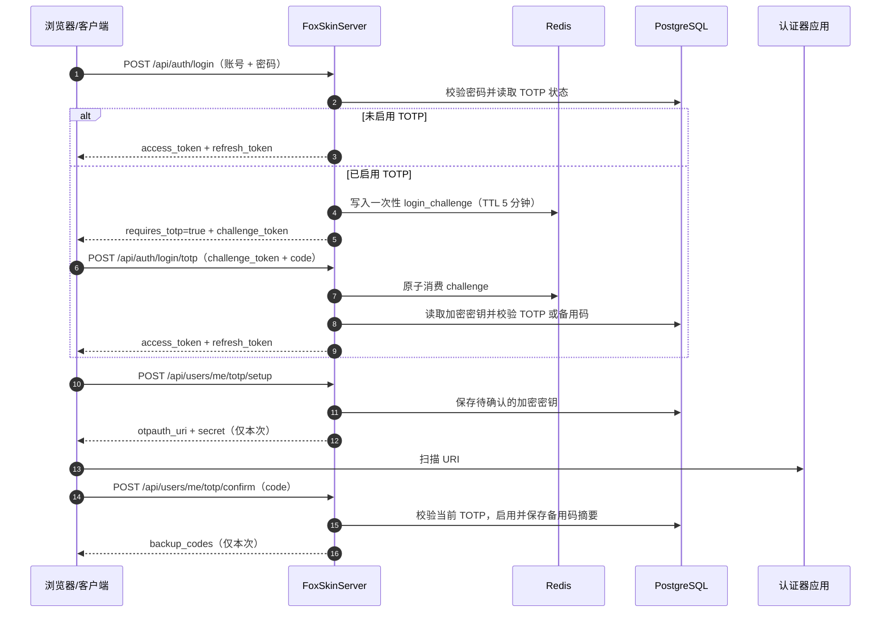

# TOTP 用户登录验证设计

## 1. 目标与范围

TOTP（基于时间的一次性密码）作为站内密码登录的第二因素。用户先提交用户名/邮箱和密码；已启用 TOTP 时，密码正确后进入一次性登录挑战，只有提交有效的 TOTP 或备用码后才签发现有 access token 和 refresh token。

本方案包含：

- 用户启用、确认、停用 TOTP；
- 生成 otpauth URI，供认证器应用扫描二维码或手工录入；
- 生成一次性备用码，并支持重新生成；
- 登录时使用 TOTP 或备用码完成二次验证；
- 防重放、限时、限流和审计要求。

本方案只描述应用、数据和接口设计，不创建数据库迁移脚本。项目当前使用 JPA `ddl-auto=update` 时，由实体变更自动维护开发环境表结构；生产环境仍应由发布流程执行等价的结构变更。

## 2. 设计原则

- **密码验证优先**：TOTP 不能绕过密码；密码错误不透露该账号是否启用 TOTP。
- **令牌后置签发**：启用 TOTP 的账号在第二因素完成前不获得 access token、refresh token 或已认证的 SecurityContext。
- **密钥不可逆暴露**：TOTP 秘钥以应用级加密密文保存，解密密钥通过环境变量或密钥管理系统注入；接口和日志不返回明文秘钥。
- **备用码只显示一次**：备用码只在启用或重新生成时返回，服务端仅保存每个备用码的不可逆摘要和消费状态。
- **一次性挑战**：登录挑战短期有效、绑定用户和密码验证结果，并通过 Redis 原子更新与消费，防止重复提交和跨用户使用。
- **兼容现有令牌体系**：完成二次验证后仍调用 `AuthService.issue`，不新增另一套 JWT 格式。
- **明确失败**：TOTP 配置损坏、解密失败、Redis 不可用或时钟异常时拒绝验证，不降级为仅密码登录。

## 3. 总体流程



## 4. 数据模型

建议新增实体 `UserTotp`，与 `User` 一对一关联：

| 字段 | 类型 | 说明 |
| --- | --- | --- |
| `id` | `Long` | 主键 |
| `user_id` | `Long` | 唯一外键，关联用户 |
| `secret_ciphertext` | `String` | AES-GCM 加密后的 Base64 密文，包含随机 nonce |
| `pending_secret_ciphertext` | `String?` | 尚未确认的密钥；确认成功后转入正式密钥 |
| `enabled` | `Boolean` | 是否要求登录二次验证 |
| `confirmed_at` | `LocalDateTime?` | 首次确认时间 |
| `last_used_time_step` | `Long?` | 最近成功使用的 TOTP 时间步，用于防同一窗口重放 |
| `created_at` | `LocalDateTime` | 创建时间 |
| `updated_at` | `LocalDateTime` | 更新时间 |

备用码建议独立实体 `UserTotpBackupCode`，避免在一个字段中保存可变列表：

| 字段 | 类型 | 说明 |
| --- | --- | --- |
| `id` | `Long` | 主键 |
| `user_id` | `Long` | 用户主键，建立索引 |
| `code_digest` | `String` | HMAC-SHA-256 摘要；密钥使用独立的服务端 pepper |
| `used_at` | `LocalDateTime?` | 已消费时间；为空表示可用 |
| `created_at` | `LocalDateTime` | 生成时间 |

备用码生成 10 个，每个 10 位数字，展示格式可为 `12345-67890`；校验时移除空格和连字符并限制为 ASCII 数字。数据库不保存明文备用码。`code_digest` 必须唯一地绑定用户和代码，比较使用常量时间比较或数据库等价安全比较。

## 5. TOTP 参数与密钥保护

- 算法：标准 RFC 6238，HMAC-SHA1，6 位数字，30 秒时间步；认证器生态兼容性优先。
- 校验窗口：当前时间步前后各 1 步，最多接受 90 秒范围；成功后记录实际命中的时间步。
- 同一用户同一时间步只允许成功一次；并发请求通过数据库条件更新或 Redis 原子操作保证。
- `otpauth://totp/...` 的 issuer 使用站点配置名，account 使用用户邮箱；URI 中不记录密码或备用码。
- `TOTP_ENCRYPTION_KEY` 使用 256 位随机密钥，禁止使用 JWT secret、数据库密码或固定默认值。
- 加密采用 AES-GCM，每条密文使用随机 12 字节 nonce；密文格式至少包含版本号、nonce 和 ciphertext/tag，便于将来轮换。
- 解密失败视为服务错误并拒绝验证，同时记录不含密钥内容的告警。

## 6. HTTP API

所有当前用户接口都需要现有 access token；输入直接声明在控制器方法上，JSON 字段使用 snake_case。

### 6.1 查询状态

`GET /api/users/me/totp`

返回：

```json
{
  "enabled": true,
  "confirmed_at": "2026-10-05T12:30:00",
  "remaining_backup_codes": 7
}
```

不返回 secret、URI、备用码明文或摘要。

### 6.2 开始启用

`POST /api/users/me/totp/setup`

要求重新输入当前密码，避免已登录会话被劫持后直接绑定攻击者设备。服务端生成新的 pending secret，返回一次性配置数据：

```json
{
  "otpauth_uri": "otpauth://totp/FoxSkin:user@example.com?...",
  "secret": "JBSWY3DPEHPK3PXP"
}
```

如果已有启用配置，接口拒绝并要求先停用；重复 setup 会覆盖未确认的 pending secret。

### 6.3 确认启用

`POST /api/users/me/totp/confirm`

参数：`code`、`current_password`。校验 pending secret 的 TOTP 后，将其转为正式 secret，生成 10 个备用码并一次性返回：

```json
{
  "enabled": true,
  "backup_codes": ["12345-67890", "..." ]
}
```

成功响应之后不再通过任何接口返回这些备用码。确认失败不改变现有启用状态。

### 6.4 停用

`POST /api/users/me/totp/disable`

要求当前密码和有效 TOTP 或备用码。成功后删除正式密钥、pending secret、所有备用码和 Redis 登录挑战，并使旧挑战全部失效。

### 6.5 重新生成备用码

`POST /api/users/me/totp/backup-codes/regenerate`

要求当前密码和有效 TOTP 或现有备用码。旧备用码全部标记失效，新生成 10 个并仅返回一次。该操作不改变 TOTP 秘钥和启用状态。

### 6.6 登录第二步

现有 `POST /api/auth/login` 增加成功但未完成登录的响应：

```json
{
  "requires_totp": true,
  "challenge_token": "随机高熵一次性值",
  "expires_in": 300
}
```

此响应不得设置 refresh cookie，也不得返回 access token。新增：

`POST /api/auth/login/totp`

参数：`challenge_token`、`code`。`code` 可以是 6 位 TOTP，也可以是备用码。成功后返回现有 `TokenData` 并设置 refresh cookie。失败统一返回“验证码错误或已过期”，不区分 TOTP 和备用码，也不透露剩余备用码数量。

## 7. 登录挑战与限流

Redis key 实现为：`auth:totp-challenge:{challenge_hash}`，值包含 `user_id`、失败次数和短暂的并发占用 nonce，TTL 300 秒；用户索引为 `auth:totp-challenges-user:{user_id}`。Redis 中只存 challenge 的 SHA-256，不存明文 challenge。

- challenge 必须由密码校验成功后创建，随机值至少 32 字节；响应传递 Base64URL 编码值。
- 验证请求先原子读取并锁定 challenge；验证码错误时原子递增失败次数，达到上限后删除 challenge；验证码正确时校验通过后原子删除 challenge。成功、过期或达到失败上限后不可再次使用。
- 删除操作必须带 challenge 当前值或版本条件，避免两个并发请求同时通过校验；Redis 不支持事务条件时使用 Lua 脚本实现读取、计数和删除的一致性。
- 单 challenge 最多失败 5 次；同用户和客户端 IP 采用滑动窗口限流，建议 10 分钟最多 10 次。
- 密码登录和 TOTP 登录失败均使用统一错误信息，避免账号枚举；日志只记录用户 ID、结果和请求 ID，不记录 code、secret、challenge 或备用码。
- 备用码成功消费必须使用条件更新 `used_at is null`，并在事务内完成，防止并发双消费。

## 8. 安全、恢复与运维

- 所有启用、停用、重新生成操作必须走 HTTPS，并要求当前密码；高风险操作可额外要求当前 TOTP。
- 前端应在内存或受保护状态中短暂保存 challenge，不写入 localStorage；页面刷新后重新登录。
- 当备用码少于 3 个时，在已认证的账户设置页提示用户重新生成，但不在未完成登录的错误响应中提示。
- 用户丢失认证器且没有备用码时，只能通过站点人工恢复流程；恢复流程应验证邮箱/管理员审批并吊销全部会话，再清除 TOTP 配置。
- 改密、账号封禁、人工恢复时吊销现有 refresh token，并删除未完成的 TOTP 登录挑战。
- 审计事件记录：启用确认、停用、备用码重新生成、备用码消费、TOTP 验证失败次数和人工恢复；审计数据不得包含密钥或验证码。
- 多实例部署必须共享 Redis；实例之间共享同一 TOTP 加密密钥和备用码 pepper。服务器时钟通过 NTP 同步。

## 9. 与现有模块的落点

- `AuthService.login`：密码成功后查询 TOTP 状态；未启用时保持现有 `issue` 行为，已启用时创建 challenge。
- `AuthController`：保留现有输入声明方式，增加 `login/totp` 端点，并在方法内声明响应 data class。
- 新增 `TotpService`、`TotpRepository`、`TotpBackupCodeRepository` 和 `TotpCryptoService`，均按实体职责拆分，不引入通用 CRUD 控制器。
- `UserController`：增加当前用户 TOTP 管理端点；响应映射直接写在各 endpoint 内。
- `SecurityConfig`：`/api/auth/login/totp` 公开，但只接受 Redis 中的短期 challenge；其他管理端点继续要求 access token。
- 前端登录状态新增 `requires_totp` 分支；账户页提供配置、确认、停用和备用码展示流程。

## 10. 验收标准

1. 未启用 TOTP 的现有登录、刷新、登出行为完全兼容。
2. 已启用 TOTP 时，密码正确不能直接获得任何站内令牌。
3. 有效 TOTP 可在允许窗口内完成登录，同一时间步不能重放。
4. 每个备用码只能成功使用一次，重复使用失败；重新生成后旧码全部失效。
5. challenge 过期、消费、失败次数超限后均不能继续验证。
6. 数据库、Redis、日志、响应中不存在明文长期 secret 或备用码（首次生成响应除外）。
7. 解密失败、Redis 故障和并发消费均按失败关闭处理，并有可检索审计记录。
